### Hi, I'm Said

Small software, self-hosted. Go, SQLite, and the occasional WordPress rescue — notes at [srmdn.com](https://srmdn.com).

---

**Self-hosted**

- [plink](https://github.com/srmdn/plink) — link shortener, bio page, and article publisher. Go + SQLite.
- [foliocms](https://github.com/srmdn/foliocms) — lightweight CMS for Astro: markdown files, SQLite, REST API.
- [lontong](https://github.com/srmdn/lontong) — server control panel. Go + Caddy + React.

**Quran tooling**

- [quran-tracker](https://github.com/srmdn/quran-tracker) — community tilawah and murojaah tracker. Bun + Hono.
- [hifzlink](https://github.com/srmdn/hifzlink) — find and compare mutashabihat verses. Go + SQLite.

**Dev CLI**

- [opcode-switch](https://github.com/srmdn/opcode-switch) — switch between OpenCode Go accounts in one command.

---

[Blog](https://srmdn.com) · [Ko-fi](https://ko-fi.com/srmdn) · [Trakteer](https://trakteer.id/srmdn/tip)
